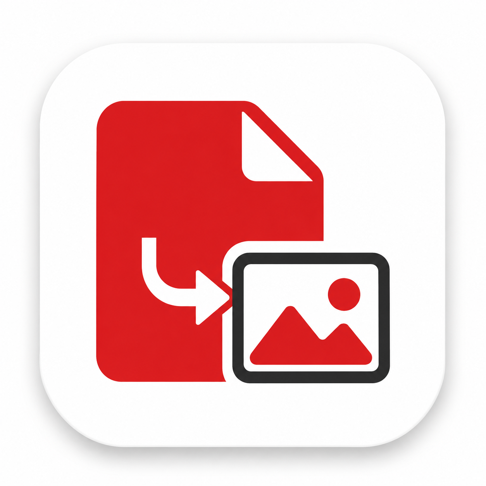

  

  # PDF Image Converter

  **PDFを、必要な画像形式へ。**

  Windows上で完結する、シンプルなPDF画像変換アプリです。

  

    
    
    
    
    
  

---

## ✨ 概要

PDF Image Converter は、PDFの各ページを PNG / JPEG / WebP / SVG に変換する Windows 向けデスクトップアプリです。
PDFファイルと変換結果はPC内だけで処理され、外部サーバーへアップロードされません。

## 🚀 インストール

1. [Releases](https://github.com/Quantum8060/PDFconversion/releases) から PDF Image Converter Setup x.y.z.exe をダウンロードします。
2. セットアップを実行し、案内に従ってインストールします。
3. スタートメニュー、またはデスクトップのショートカットから起動します。

> [!NOTE]
> 現在のインストーラーはコード署名されていません。Windows の警告が出た場合は、内容を確認したうえで「詳細情報」から実行してください。

## 🖼️ 主な機能

| 機能 | 内容 |
| --- | --- |
| 入力 | PDFのドラッグ＆ドロップ、またはファイル選択 |
| 出力形式 | PNG / JPEG / WebP / SVG |
| 画像抽出 | 選択ページに埋め込まれた画像をPNGとしてZIPに保存 |
| ページ指定 | 全ページ、範囲、個別ページを指定可能 |
| 複数ページ | 変換結果をZIPファイルへまとめて出力 |
| 画質設定 | 用途に合わせた画質・解像度のプリセットと倍率指定 |
| プレビュー | PDF全体のサムネイルを表示 |
| パスワード付きPDF | パスワード入力を求めて読み込み |
| 保存 | ファイル名と保存先を指定して出力 |
| 設定保持 | 前回の形式・画質・倍率を次回起動時に復元 |

## 🖱️ エクスプローラーから使う

PDFを右クリックすると、次の項目からすぐに起動・変換できます。

- PDF Image Converterで変換
- PNGに変換（標準）
- JPEGに変換（標準）

PNG / JPEG の標準変換では、保存先とファイル名を選んでから変換を開始します。

## 🔒 プライバシー

- PDFの解析・変換はすべてローカルPC上で行います。
- PDFの内容や変換結果を外部サーバーへ送信しません。
- 更新確認時のみ、GitHub Releasesの公開情報を取得します。

## 🔄 アップデート

アプリの「アップデートを確認」から、新しいバージョンの有無を確認できます。
新しい版が見つかった場合は、ブラウザでReleaseページを開いてインストーラーをダウンロードします。

## 🛠️ 開発・ビルド

開発環境の準備、Windowsインストーラーの作成、GitHub Releasesの設定は [setup.md](setup.md) を参照してください。
